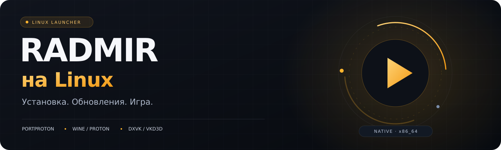

<p align="center">
  
</p>

<p align="center">
  
  
  
  
  <a href="LICENSE"></a>
</p>

<p align="center">
  <strong>Независимый лаунчер RADMIR для Linux.</strong><br>
  Подготовка PortProton, обновление игры и запуск — в одном приложении.
</p>

<p align="center">
  <a href="https://github.com/Lorodn4x/radmir-launcher-linux/releases"><strong>Релизы</strong></a>
  &nbsp; · &nbsp;
  <a href="docs/INSTALL.md">Установка</a>
  &nbsp; · &nbsp;
  <a href="docs/BUILD.md">Сборка</a>
  &nbsp; · &nbsp;
  <a href="CONTRIBUTING.md">Участие в разработке</a>
</p>

---

### От первого запуска до игры

1. **Откройте лаунчер.** Он проверит среду и подготовит отсутствующие компоненты PortProton.
2. **Дождитесь готовности.** Существующие игровые файлы проверяются; недостающие и обновлённые скачиваются.
3. **Выберите сервер и никнейм.** Когда среда готова, нажмите **«Играть»**.

Если нужны системные пакеты, приложение сначала показывает план и запрашивает стандартное подтверждение администратора.

### Всё необходимое для запуска

| Возможность | Что делает лаунчер |
| :--- | :--- |
| **Подготовка среды** | Устанавливает официальные компоненты Native PortProton и восстанавливает повреждённые. |
| **Выбор Wine / Proton** | Позволяет выбрать конкретную сборку и сохраняет её в настройках. |
| **Выбор 3D API** | DXVK/VKD3D, стабильный профиль, Sarek или WineD3D/OpenGL. |
| **Обновления игры** | Показывает доступное обновление и предлагает загрузить его кнопкой. |
| **Проверка файлов** | Проверяет контрольные суммы и восстанавливает отсутствующие или изменённые файлы. |
| **Фоновая работа** | Подготовка и игра продолжаются после закрытия окна; при открытии возвращается текущий статус. |
| **Понятные ошибки** | Показывает причину, возможность повтора и путь к журналу. |

<details>
<summary><strong>Параметры первой установки</strong></summary>

- Wine/Proton: **PROTON_LG_10-28**.
- 3D API: новейший профиль **DXVK/VKD3D** PortProton.
- DXVK этого профиля требует **Vulkan 1.3**. Совместимость проверяется через используемый Wine и 32-битный графический путь.
- Wine и 3D API выбираются независимо от игрового пресета «Стандартная / улучшенная графика».

</details>

### Установка

Планируемые форматы распространения: **AppImage** и **DEB** для x86_64.

Для AppImage:

```bash
chmod +x RADMIR-Standalone-0.1.1-x86_64.AppImage
./RADMIR-Standalone-0.1.1-x86_64.AppImage
```

Инструкции для DEB, системных пакетов и проверки SHA256 — в [руководстве по установке](docs/INSTALL.md). Наличие готовых файлов смотрите в конкретном релизе.

### Системные требования

- Linux **x86_64**. Протестировано на Ubuntu **26.04**.
- GPU и драйвер, совместимые с выбранным графическим профилем.
- Достаточно места для игры, среды Wine, временных архивов и распаковки.
- Доступ к интернету для первичной подготовки, обновлений и подключения к серверам.

Совместимость зависит от GPU, драйвера и Wine. Подтверждённые конфигурации и ограничения указываются в описании каждого релиза; целевая ОС сама по себе не означает завершённую проверку на любом оборудовании.

### Для разработчиков

Интерфейс — HTML/CSS/JavaScript. Локальная логика, загрузки и отдельный worker — Rust/Tauri 2. Настройки и состояние хранятся в SQLite. PE32 helpers собираются из собственных C-исходников.

```bash
npm ci
npm run build:runner
npm test
cargo test --manifest-path src-tauri/Cargo.toml --locked
```

[Полная инструкция сборки](docs/BUILD.md) · [Правила участия](CONTRIBUTING.md) · [Сторонние компоненты](docs/THIRD_PARTY_NOTICES.md)

Собственные исходники и оформление распространяются по [Apache-2.0](LICENSE).
Лицензии сторонних компонентов сохраняются отдельно.

---

**Статус:** экспериментальная версия. Никнейм и сервер выбираются в лаунчере, пароль вводится в игре. Автоматическая установка Flatpak пока не реализована.

RADMIR Linux — независимый проект, не официальный продукт RADMIR. Игра, товарные знаки и серверы принадлежат их правообладателям. Игровые файлы и PortProton не входят в исходный репозиторий и загружаются отдельно.

<sub>Independent RADMIR launcher for Linux, built with Rust and Tauri.</sub>
